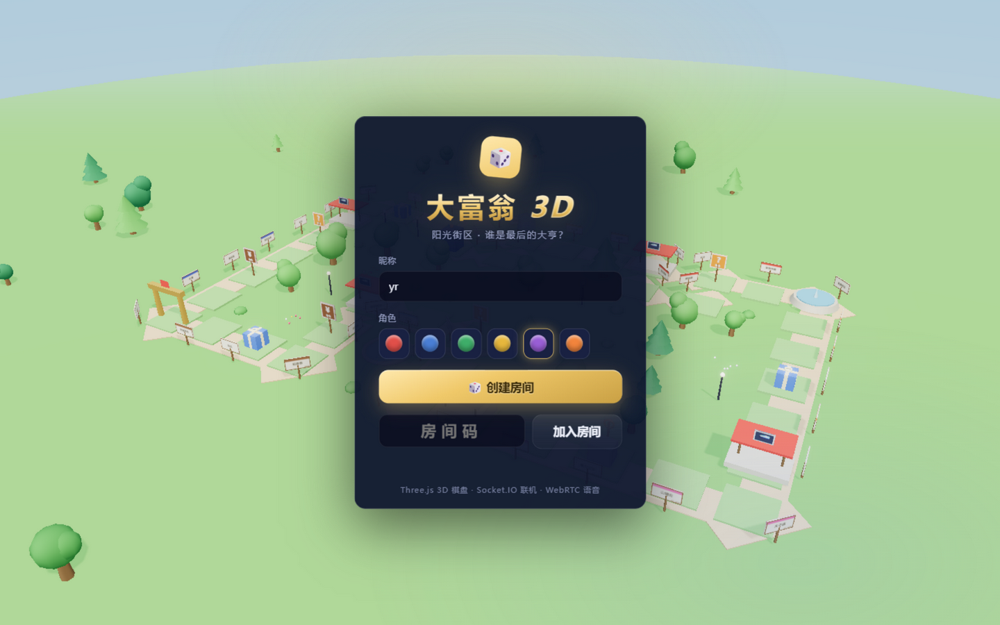
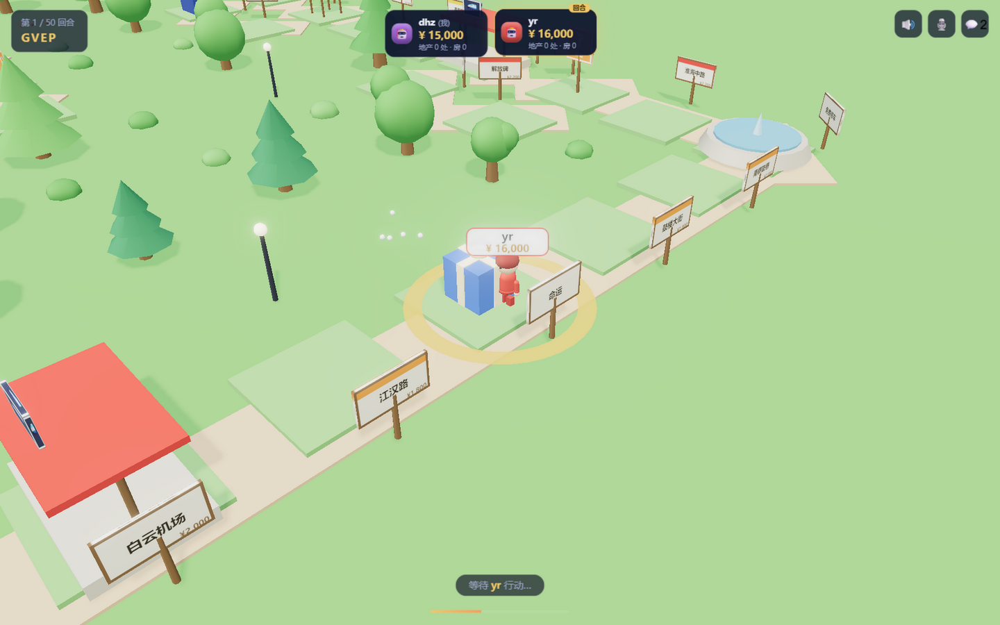
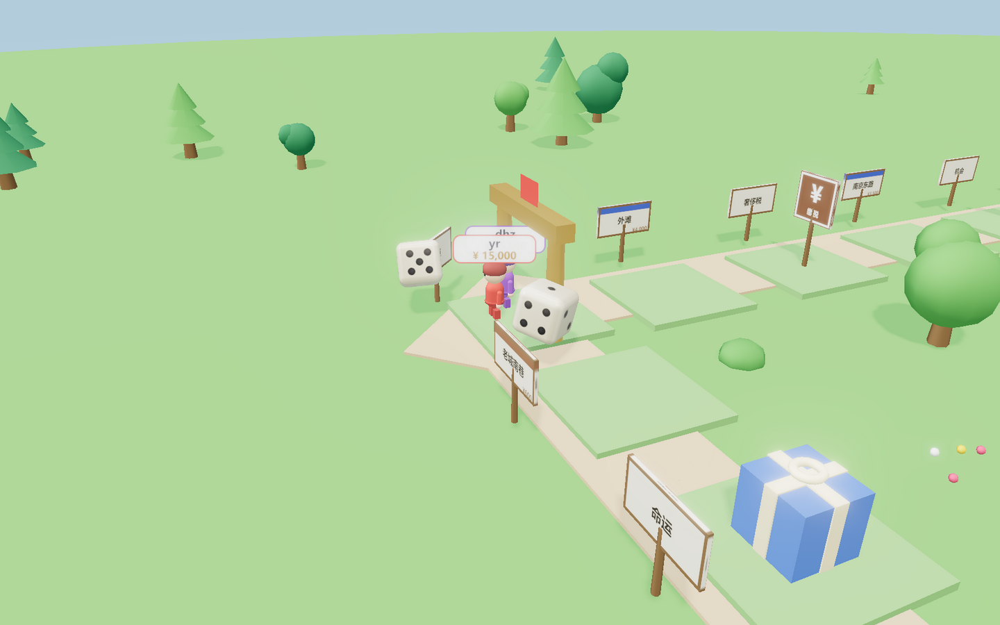
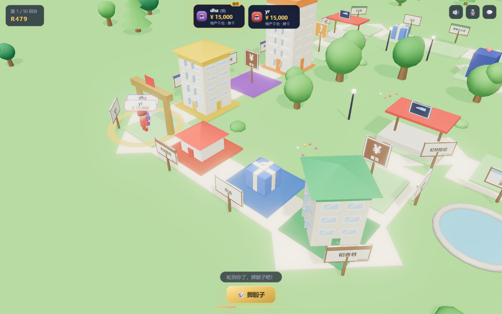

# 大富翁 3D · Richman 3D 🎲

> 阳光街区 · 谁是最后的大亨？
> 网页版大富翁：Three.js 3D 街区世界 + Socket.IO 多人联机 + 文字聊天 + WebRTC 实时语音

| 大厅 | 局部跟随视角 | 街边建筑成长 | 地契卡 |
|---|---|---|---|
|  |  |  |  |

参考《大富翁4》的呈现方式设计：**不是一圈方形跑道俯瞰全场**，
而是一张大地图上的蜿蜒闭合街区（内院水池、车站、公园、警亭），
对局中镜头**局部跟随当前角色**卷动；买地后地上盖起**真正的房子**，
随投资逐层长高（小屋 → 2~5 层楼房 → 带招牌的酒店塔楼）；
Q 版小人沿街行走，手脚摆动，骰子掷在角色身旁的街面上。

## ✨ 功能

- **3D 棋盘**：40 格中国城市街道主题棋盘，程序化生成的星夜都会远景（楼群灯光/星空）、
  圆角 3D 骰子掷骰动画、Q 版机器人棋子（逐格跳跃/入狱大跳/庆祝/破产倒下）、房屋酒店建筑、
  金额飘字、胜利彩带、Bloom 辉光后期。
- **多人联机**：房间码邀请（可复制链接直达）、2~6 人开局、服务器权威状态、
  75 秒回合计时（挂机自动行动，对局永不卡死）、**掉线 30 秒内自动重连同席恢复**。
- **完整规则**：双骰移动/双数再掷/三双入狱、买地即可建房（单块独立升级，无需集齐同色）/酒店、
  阶梯租金与垄断双倍、车站 4 档租金、水电按骰点计费、抵押/赎回（10% 手续费）、
  机会/命运各 12 张卡、所得税/奢侈税、监狱三回合规则、破产清算（自动拆房抵押）、
  50 回合按总资产结算，或最后幸存者获胜。
- **文字聊天**：实时消息、表情快捷键、未读红点、战报流水（对局事件全记录）。
- **实时语音**：WebRTC P2P mesh，进入房间即建链，开麦即说；采用静音占位轨 +
  `replaceTrack` 热切换，开/关麦不触发重协商。
- **结束与续局**：结束对局需全员同意，可直接退出或保存后结束；回到大厅输入存档码，
  原玩家可恢复席位并继续对局。存档保存在服务端 `saves/` 目录。
- **零素材依赖**：贴图/音效/模型全部程序化生成，安装依赖即可运行，无外网请求。

## 🚀 快速开始

```bash
cd richman-3d
npm install

# 开发模式（服务端 :3000 + 前端热更新 :5173，同时启动）
npm run dev
# → 打开 http://localhost:5173

# 生产模式（前后端同域，单端口）
npm run preview          # = vite build + node server
# → 打开 http://localhost:3000
```

> 语音需要安全上下文：`localhost` 直接可用；局域网 IP 访问时浏览器可能禁用麦克风，
> 部署到服务器请走 HTTPS（见下文）。

## 🎮 玩法

1. 输入昵称、选一个机器人角色，**创建房间**，把 4 位房间码（或邀请链接）发给朋友；
2. 2~6 人到齐后房主点击**开始对局**；
3. 按空格/点按钮**掷骰子**，落点可**买地**；点击棋盘任意格子查看**地契卡**；
4. 拥有地产后即可在自己回合**建房**（单块独立升级，无需集齐同色），租金按阶梯翻倍；
5. 现金不足付租金时会自动拆房、抵押；仍不足即破产出局；
6. 🎙️ 按钮开麦语音，💬 打字聊天，⏎ 结束回合，空格掷骰。
7. 需要提前结束时点 🚪 发起全员投票；选择保存并结束后，回大厅输入显示的存档码并点
   **使用存档码继续对局**即可恢复。

## 🏗️ 架构

```
richman-3d/
├─ server/                 # Node.js 服务端（Express + Socket.IO）
│  ├─ index.js             # HTTP + WebSocket 入口、REST(/api/*) 预留接口
│  ├─ config.js            # 端口/房间参数/部署环境变量
│  ├─ rooms.js             # 房间管理：加入/离开/掉线宽限/回合计时/动作分发
│  └─ game/
│     ├─ constants.js      # 40 格棋盘数据（单一来源，前后端共享 @board）
│     ├─ cards.js          # 机会/命运卡池
│     ├─ engine.js         # 大富翁规则引擎（纯逻辑、服务器权威、事件流输出）
│     └─ engine.test.mjs   # 随机 200 局回归测试 + 银行流水守恒校验
└─ client/                 # Vite 前端
   └─ src/
      ├─ main.js           # 装配：Socket 事件 → 事件导演 → 3D/UI
      ├─ three/            # scene（灯光/后期/都市）/ board / tokens / dice / effects
      ├─ ui/               # lobby / hud（玩家卡/行动栏/地契/结算）/ chat
      ├─ net/              # socket 封装 / WebRTC 语音 / 部署配置
      ├─ audio/sfx.js      # Web Audio 程序化音效
      └─ game/store.js     # 事件总线 + 客户端状态
```

**同步模型**：服务端 `engine` 产生「事件流」（掷骰/逐格移动/收支/卡片…）+「状态快照」，
客户端按顺序播放事件动画，动画结束后对齐快照——不可回放的竞态一律以服务端为准。

## 🔌 协议一览

| 客户端 → 服务端 | 说明 |
|---|---|
| `room:create / room:join / room:rejoin / room:resume / room:leave` | 房间生命周期（断线重连、存档恢复） |
| `game:start` | 房主开局 |
| `game:action {action: roll/buy/decline/build/sellHouse/mortgage/unmortgage/payJail/useCard/endTurn}` | 游戏动作（服务端全量校验） |
| `game:vote {action: request/vote/cancel}` | 发起结束投票、表决或取消；全员同意后保存或退出 |
| `chat:msg` | 文字聊天 |
| `voice:hello / voice:signal / voice:mute` | WebRTC 信令（服务器只转发） |

| 服务端 → 客户端 | 说明 |
|---|---|
| `room:state` / `game:state` | 房间与对局快照 |
| `game:events` | 动画事件流（dice/move/money/rent/card/jail/win…） |
| `game:timer` | 回合倒计时 |
| `chat:msg` / `voice:*` | 聊天与语音信令 |

## 🛰️ 部署到服务器（预留接口）

```bash
# 构建前端
npm run build

# 单进程同域部署（推荐）：服务端自动托管 client/dist
PORT=80 HOST=0.0.0.0 node server/index.js

# 前后端分离部署：静态站托管 client/dist，服务端单独跑
SERVE_CLIENT=false PORT=3000 CORS_ORIGIN=https://your-frontend.domain node server/index.js
# 前端访问时加 ?server=https://api.domain（或改 client/src/net/config.js 的 DEFAULT_SERVER）
```

- 所有配置都可通过环境变量覆盖（`PORT/HOST/CORS_ORIGIN/PUBLIC_URL/SERVE_CLIENT`）。
- **语音必须 HTTPS**（浏览器限制）；NAT 复杂环境可在 `client/src/net/voice.js` 的
  `ICE_SERVERS` 中加入 TURN 服务器（预留位）。
- 已提供 `GET /api/health`、`GET /api/config`、`GET /api/rooms` 健康检查与房间查询，
  便于负载均衡/监控接入。

## 🧪 测试

```bash
npm test
# → 结束投票与存档恢复集成测试 + 200 局随机对局回归
```

## 👥 团队（cofounders）

| 成员 | 分工 |
|---|---|
| **dhz** | 项目架构、脚手架、房间/联机系统、断线重连、部署预留接口 |
| **waz** | 大富翁规则引擎、卡牌与经济系统、回归测试 |
| **yr** | 3D 场景与美术（棋盘/棋子/骰子/后期）、前端 UI（大厅/HUD/地契） |
| **gsl** | 文字聊天、WebRTC 实时语音、文档与测试报告 |

Git 历史按功能分块提交，每次提交注明对应成员（见 `git log`）。

## 📚 调研与素材说明

见 [RESEARCH.md](../RESEARCH.md)：开工前对免费 API/资源（3D 人物模型、地图服务、
CDN 可达性）的调研结论。本项目运行时零外网依赖，所有视觉/音频资产均为程序化生成。

## 📜 许可

- 代码：课程作业，仅用于教学用途
- 依赖：three.js / socket.io / express / vite（均 MIT）
