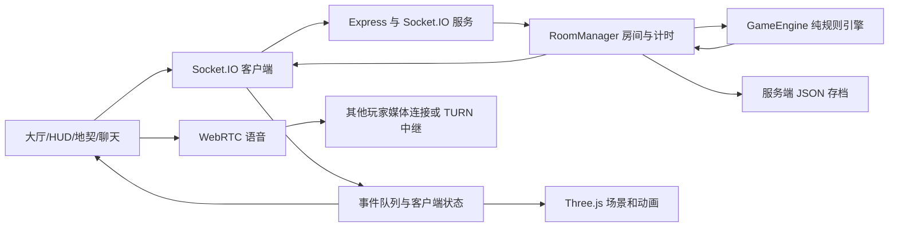
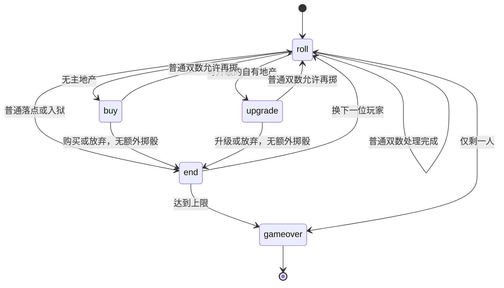

# Richman 3D 多人大富翁软件工程课程实验报告

## 项目基本信息

| 项目 | 内容 |
|---|---|
| 课程 | 软件工程 |
| 项目名称 | Richman 3D 多人大富翁网页游戏 |
| 班级、组名、指导教师 | 待填写 |
| 成员姓名及学号 | dhz、waz、yr、gsl 为项目署名；真实姓名和学号待填写 |
| 代码仓库 | https://github.com/TG816/richman-3d |
| 报告日期 | 2026-11-02 |
| 对应软件版本 | `9aba7ae`，本报告的证据采集基线 |
| 在线地址 | 待填写实际 HTTPS 地址并完成线上验收 |

本项目面向小组休闲娱乐，提供浏览器内的三维棋盘、多人回合制对局、地产经营和即时交流。项目采用客户端负责表现、服务器负责规则的结构。当前已实现主要游戏流程，并通过自动化规则测试与构建检查；跨设备语音、线上完整对局等仍需按本文测试计划补充验收记录。

本文按照课程要求中的“选题、需求分析、设计文档、测试报告”组织。NABCD、用户反馈及过程证据参考课程任务书补充，不将旧任务书中的历史截止日期、示例选题或评分比例作为本次课程的确定要求。项目使用 AI 辅助编程、排错与文档整理；分工表表示模块职责，不能以署名字段代替实际参与说明。

## 一、选题说明

### 1.1 选题背景与目标

传统桌面棋盘游戏需要玩家聚在同一地点，准备实体棋盘并手工计算资金与租金。本项目将回合、资产和随机事件交由程序处理，使玩家通过房间码在浏览器中加入对局，同时保留掷骰、行走、建房等可视化反馈。

课程目标不只是制作一个游戏画面，而是通过需求分析、模块划分、协议设计、状态管理、测试和版本维护形成可运行的软件。大富翁具备明确的状态转换与经济规则，适合展示软件工程中的可测试性、职责分离和异常处理。

### 1.2 NABCD 分析

| 维度 | 项目分析 |
|---|---|
| N：需求 | 同学希望快速建立多人休闲对局，减少手工记账、规则争议及安装步骤，并能边玩边交流。该需求是项目假设，尚未形成独立问卷统计。 |
| A：方法 | 以浏览器作为入口，使用房间码联机；服务端统一判定规则，前端以三维场景呈现结果；增加聊天、语音、存档与恢复。 |
| B：收益 | 邀请与加入路径简短，资金和回合自动处理，三维动画便于观察，存档允许中断后继续。实际易用性需通过用户试玩验证。 |
| C：替代方案 | 实体棋盘侧重面对面体验；成熟商业大富翁产品功能更丰富。本项目定位为课程可解释、可修改的小规模网页实现，不声称功能或性能超过商业产品。 |
| D：交付 | 提供 GitHub 源码、README、报告、可构建静态资源与 Node.js 服务；通过 HTTPS 站点供用户试玩，线下验收准备本地运行环境。 |

### 1.3 项目范围与特色

已实现一个 40 格城市主题棋盘、2–6 人房间联机、地产与事件规则、文字和语音交流、存档续局。角色、建筑、贴图与游戏音效主要通过代码生成；背景音乐使用用户提供的《朋友的酒》MP3。

特色是服务器统一判定规则与客户端动画表现分离、独立的队友收听设置、基于事件队列的动画同步，以及可自动执行的规则回归测试。本项目混合了经典 Monopoly 的部分机制与国产大富翁式落地升级玩法，不宣称完整复刻某个官方版本。

本次范围不包含 AI 对手、三套可选地图、注册登录、付费系统或大规模服务器集群。旧项目中的相应设想不作为当前实现成果。

## 二、需求分析

### 2.1 用户与使用场景

| 角色 | 主要操作 |
|---|---|
| 房主 | 创建房间、邀请玩家、启动对局，参与游戏及结束投票 |
| 普通玩家 | 输入昵称和角色、加入房间、掷骰经营、聊天语音、投票及续局 |
| 部署维护者 | 安装依赖、启动服务、配置 HTTPS 与语音中继、备份存档 |

典型流程：创建房间 → 分享邀请链接或房间码 → 至少两人加入 → 房主开始 → 轮流掷骰和处理落点 → 结束回合 → 破产或达到回合上限 → 查看结算。需要中断时，玩家可发起全员投票保存并结束，再通过存档码恢复。

### 2.2 功能需求与验收条件

| 编号 | 需求 | 验收条件 |
|---|---|---|
| F01 | 房间管理 | 能创建、加入房间；拒绝不存在或已满房间；至少两人才能开始 |
| F02 | 三维显示 | 可查看棋盘、角色、房屋与骰子，角色按服务端步数移动 |
| F03 | 回合控制 | 仅当前玩家执行对应阶段动作，普通双数允许再掷，三次双数入狱 |
| F04 | 地产购买与升级 | 无主地产可购买或放弃；买地不立即升级；再次落到自有地产仅有一次升级机会 |
| F05 | 经济系统 | 自动收租，可拆房、抵押、赎回；现金不足时清偿，仍不足则破产 |
| F06 | 随机事件 | 机会、命运各 12 张卡，按卡片执行金钱、移动、监狱等效果 |
| F07 | 出狱卡 | 持有期间离开牌堆，使用后归还对应牌库，破产时归还 |
| F08 | 结算 | 回合上限或最后幸存者触发终局；两种方式均使用统一总资产口径 |
| F09 | 交流 | 同房文字聊天、实时语音；每位队友可独立调整收听音量或本地静音 |
| F10 | 音频控制 | 游戏音效和背景音乐独立控制；背景音乐默认关闭，音量默认 25% |
| F11 | 续局 | 全员同意后保存；输入存档码认领席位并继续；保存新版本牌库顺序 |
| F12 | 可读性 | 地契可查看属性，操作日志记录过程；骰子悬空投掷并显示固定点数 |

### 2.3 默认参数与规则约定

参数由 `server/config.js` 管理：初始现金 15,000，经过起点工资 2,000，回合上限 50，单阶段超时默认 75 秒，房间码长度 4，最大玩家数 6。断线席位宽限在 `server/rooms.js` 中设置为 60 秒。

地产升级以再次落点为资格，不要求集齐同色；同色地产持有情况仍用于部分租金计算。普通双数可再次掷骰，但双数出狱后的这次移动不奖励再掷。赎回抵押地产支付抵押金额及 10% 手续费。总资产按现金、未抵押地产购入价、抵押地产半价及建筑投入计算。

### 2.4 非功能需求与异常情况

- 一致性：客户端只提出动作，服务器校验当前玩家及阶段，广播统一结果。
- 可维护性：规则引擎不依赖 Three.js、DOM 或 Socket.IO，显示与通信分别放置。
- 稳定性：重复升级、非本人回合操作、资金不足应被拒绝；超时购地或升级自动放弃。
- 可用性：关键结果有中文提示，骰子点数同时以数字显示，音频控件有可访问名称。
- 部署：本地支持 Node.js 启动；公网语音需有效 HTTPS，复杂网络依赖 STUN/TURN。
- 性能：设计面向最多 6 人的小房间；尚未测得并发房间容量、移动端最低帧率或网络时延上限，不写为已达成指标。

异常场景包括断网重连、切换房间、浏览器拒绝麦克风权限、媒体播放限制、资金不足、玩家破产、存档码无效、投票拒绝与超时。已有处理并不等于所有异常均已完成人工验收。

## 三、设计文档

### 3.1 总体架构与技术选型



前端采用原生 JavaScript、Vite 与 Three.js；后端采用 Node.js、Express 和 Socket.IO。WebRTC 负责语音媒体传输，Socket.IO 负责协商信令。背景音乐由 HTML Audio 播放，游戏音效由 Web Audio 合成。工程具体依赖版本以 `package-lock.json` 为准。

生产构建生成 `client/dist`，可由 Express 同域托管；开发时 Vite 将 `/api` 与 `/socket.io` 代理到后端。当前方案为单进程内存房间配合文件存档，没有关系数据库，也没有集群共享状态。

### 3.2 模块职责与团队分工

| 成员署名 | 模块职责 | 主要文件 |
|---|---|---|
| dhz | 工程架构、房间联机、重连、部署衔接 | `server/index.js`、`server/rooms.js`、客户端网络层 |
| waz | 回合规则、资产、卡牌、规则测试 | `server/game/engine.js`、`cards.js`、测试文件 |
| yr | 三维场景、角色、骰子、前端交互与布局 | `client/src/three/`、`client/src/ui/` |
| gsl | 聊天语音、音频控件、文档与测试材料 | `voice.js`、`listening.js`、`chat.js`、`bgm.js` |

分工允许交叉维护，例如历史中的语音修复也有 dhz 署名。提交记录是过程证据之一，不应解释为每个模块仅由一个人独立完成。仓库采用直接提交和本地合并后推送流程，目前没有以 PR 为主的审核记录。

### 3.3 数据结构

| 数据 | 关键字段 | 用途 |
|---|---|---|
| 玩家 | `id/name/pos/money/inJail/bankrupt/getOutCards/getOutSources` | 稳定身份、位置、资产、状态与出狱卡来源 |
| 地产 | `props[tile] = {owner,houses,mortgaged}` | 所有权、建筑等级及抵押状态 |
| 对局 | `turn/round/phase/pending/lastRoll` | 当前玩家、轮次和待处理动作 |
| 牌库 | `decks/discard` | 两类牌库、弃牌与顺序 |
| 结算 | `winner/lastRanking` | 获胜者与资产金额 |
| 房间 | `code/players/engine/timer/vote` | 房间成员、引擎、计时和投票 |
| 收听设置 | 玩家 ID → `{volume,muted}` | 本浏览器内存中的队友音量，不广播 |

玩家 ID 与 Socket 连接 ID 不相同。连接 ID 会在重连时变化，房间快照提供两者映射，音量设置用稳定玩家 ID 保存，再应用到对应的接收音频元素。

### 3.4 回合状态机



图为主要流程，破产清偿也可从落点或卡牌处理中触发终局。`can` 与房间动作分发检查身份、阶段；`finishAction` 根据双数、`noExtra` 和入狱标志决定再掷或结束。购地和升级都在 `pending` 中保留 `noExtra`，防止异步选择造成限制丢失。

客户端动画队列逐个处理骰子、移动、资金及房屋事件。动画结束后对齐最新服务器快照；队列积压时可跳过动画直接应用结果。骰子点数来自服务端，不由动画随机生成。

### 3.5 经济系统与卡牌设计

`transfer` 统一执行玩家与银行收付款，记录银行净流入以支持金额守恒测试。现金不足先调用 `liquidate` 拆房、抵押；仍不足则 `bankruptPlayer` 处理退出和资产移交。`totalAssets` 被回合上限和最后幸存者结算共同使用，避免一个只算现金、另一个算总资产。

抽普通卡后进入对应弃牌堆；出狱卡进入玩家的来源列表而不进入弃牌堆。使用时从来源列表移除并放回原牌库底；破产时归还持卡。每个来源的出狱卡在牌库、弃牌和玩家持有之间保持一张实体卡。

### 3.6 联机协议

| 事件 | 方向 | 主要含义 |
|---|---|---|
| `room:create/join/rejoin/leave` | 客户端 → 服务端 | 房间生命周期 |
| `room:resume` | 客户端 → 服务端 | 输入存档码并恢复席位 |
| `game:start` | 客户端 → 服务端 | 房主请求开局 |
| `game:action` | 客户端 → 服务端 | `roll/buy/decline/build/endTurn` 等动作 |
| `game:events` | 服务端 → 客户端 | 动画与日志事件 |
| `game:state` | 服务端 → 客户端 | 对局快照，不包含完整牌序 |
| `game:timer` | 服务端 → 客户端 | 超时截止时间 |
| `game:vote` | 双向 | 保存、结束投票与结果 |
| `chat:msg` | 双向 | 文字消息 |
| `voice:hello/signal/mute` | 双向 | 媒体连接协商与麦克风状态 |

示例：`{ action: 'build', tile: 12 }` 只表达请求；服务端仍检查当前玩家、`upgrade` 阶段、待处理地块、资金和等级。队友本地静音只设置接收端 audio 的 `muted`，不会发送关闭对方麦克风的命令。

### 3.7 存档与恢复

服务端存档外层包含 `{code, savedAt, snapshot}`，存放在 `saves/`。`saveSnapshot()` 在公开快照之外增加 `cardState`，保存完整 `decks` 和 `discard`。该字段只用于服务端写盘，不随 `game:state` 广播。

`fromSnapshot` 恢复玩家、地产、待处理动作、结算和牌库。旧存档没有持卡来源或牌序，不能精确重现历史：按玩家顺序兼容分配机会、命运两张实体出狱卡，消除旧版异常重复卡并重洗剩余卡池。完整一致性验收以新版本生成的存档为准。

### 3.8 功能与代码对照

| 演示功能 | 文件 | 关键函数或入口 |
|---|---|---|
| 创建和加入房间 | `server/rooms.js` | `createRoom/joinRoom` |
| 开局与超时 | `server/rooms.js` | `startGame/armTurnTimer` |
| 掷骰和移动 | `server/game/engine.js` | `roll/walk/resolveTile` |
| 买地与落点升级 | 同上 | `buy/build/decline` |
| 租金和现金清偿 | 同上 | `calcRent/transfer/liquidate` |
| 监狱和出狱卡 | 同上 | `rollInJail/useCard/applyCard` |
| 结算资产 | 同上 | `totalAssets/finishByAssets/checkWin` |
| 存档和续局 | `server/rooms.js` | `saveGame/resumeRoom/resumeJoin` |
| 完整牌库保存 | `server/game/engine.js` | `saveSnapshot/fromSnapshot` |
| 骰子悬空动画 | `client/src/three/dice.js`、`main.js` | `Dice.roll/update`、事件导演 `play` |
| 固定点数提示 | `client/src/ui/dice-result.js` | `createDiceResult` |
| 文字聊天 | `client/src/ui/chat.js` | `initChat` |
| 语音连接与开麦 | `client/src/net/voice.js` | `wire/connectTo/toggleMic` |
| 本地音量和静音 | `net/listening.js`、`ui/listening.js` | `ListeningSettings`、`listeningControls` |
| 背景音乐 | `client/src/audio/bgm.js` | `initBgm` |

表中客户端简写路径均位于 `client/src/` 下。

## 四、测试报告

### 4.1 测试环境、方法与证据

测试基线为 `9aba7ae`，Windows 本地环境，Node.js 与 npm 实际版本见 [environment.txt](evidence/environment.txt)。规则测试采用 Node.js test runner 和随机对局模拟；构建使用 Vite。此次测试不包含网络并发压测，也不把构建成功视为真实语音已连通。

- [自动化测试原始日志](evidence/test-output.txt)
- [生产构建原始日志](evidence/build-output.txt)
- [提交历史记录](evidence/commits.txt)

本次重新运行：27 项确定性测试全部通过，200 局随机对局全部结束，平均 1377 步/局；构建成功。随机测试没有固定种子，后续运行步数可能变化。构建存在大资源包及混合动态/静态导入提示，未阻断构建，但不能据此宣称移动端性能达标。

### 4.2 自动化用例

| 编号 | 操作或输入 | 预期结果 | 实际结果 | 证据 |
|---|---|---|---|---|
| T01 | 购买后直接升级 | 拒绝，不扣费 | 通过 | `build.test.mjs` |
| T02 | 再次落地，升级后重复请求 | 仅升一级、仅扣一次 | 通过 | 同上 |
| T03 | 非本人或异地升级请求 | 拒绝 | 通过 | 同上 |
| T04 | 放弃升级后再次请求 | 旧机会失效，下次落点产生新机会 | 通过 | 同上 |
| T05 | 双数出狱后购买或放弃 | 结束回合，不再掷 | 两条路径通过 | 同上 |
| T06 | 购地等待时保存恢复后完成选择 | 保留禁止再掷限制 | 两条路径通过 | 同上 |
| T07 | 普通双数后购买或放弃 | 仍可再掷 | 两条路径通过 | 同上 |
| T08 | 资金不足、抵押或满级 | 不非法升级，能够继续回合 | 通过 | 同上 |
| T09 | 两种终局的相同资产配置 | 总资产一致，排除他人资产 | 通过 | `assets.test.mjs` |
| T10 | 结算快照恢复 | 金额保持一致 | 通过 | 同上 |
| T11 | 机会或命运出狱卡使用 | 持有时不在牌堆，使用归还原库 | 两类来源通过 | `cards.test.mjs` |
| T12 | 洗牌及持卡玩家破产 | 不复制卡片，退出后归还 | 通过 | 同上 |
| T13 | 新存档恢复与公开快照 | 恢复完整牌序，公开快照不含牌序 | 通过 | 同上 |
| T14 | 旧存档缺失来源且数量异常 | 按兼容规则保留两张实体卡 | 通过 | 同上 |
| T15 | 调一人音量、静音再解除 | 不影响其他玩家，恢复原音量 | 通过 | `listening.test.mjs` |
| T16 | 重连改变连接 ID | 根据房间映射重新应用静音 | 通过 | `rooms.test.mjs` |
| T17 | 保存投票通过、拒绝、无效路径 | 正确恢复或保留对局，拒绝无效输入 | 通过 | 同上 |
| T18 | 随机模拟 200 局 | 正常终局、金额守恒、无负现金 | 通过 | `engine.test.mjs` |
| T19 | 执行生产构建 | 生成前端产物及本地音频资源 | 通过，有资源分块提示 | 构建日志 |

用例表按场景归组，不等于 test runner 的测试数量。各测试文件中的断言与原始日志是结果依据。

### 4.3 人工验证与反馈

| 场景 | 已有反馈 | 证据级别与限制 |
|---|---|---|
| 双窗口本地静音 | 测试者先报告按钮无效，补齐连接映射后反馈“现在好了” | 来自本次开发对话反馈，不是独立第三方测试报告 |
| 静音滑块归零及恢复 | 测试者反馈“现在测试没问题了” | 本机人工反馈，未附音频录制 |
| 骰子提示位置 | 测试者截图指出遮挡玩家卡片、公告，调整到底部后认可 | 对话截图与反馈；报告内旧截图不代表最新布局 |
| 悬空投骰 | 测试者要求保留地图内投骰，修改后确认上传 | 视觉反馈，尚无多设备尺寸覆盖记录 |
| 手机局域网开麦 | 实际出现 `getUserMedia` 不可用报错 | HTTP 局域网不具备所需安全上下文，不能记为语音通过 |
| 电脑到手机收听 | 测试者曾报告无声 | 具体网络、播放或浏览器原因未定位，不列为通过 |
| HTTPS 跨设备完整通话 | 尚无本次版本完整记录 | 待验收 |

开发中已据真实反馈完成多次改进，但未开展正式用户满意度调查，不编造访谈人数、问卷比例或评分。

### 4.4 已修复缺陷

| 缺陷 | 原因 | 修复和验证 |
|---|---|---|
| 刚买地可连续升级 | 经营接口没有落点资格限制 | 独立 upgrade 阶段，一次处理后清空 pending；T01–T04 |
| 双数出狱后购地又能再掷 | noExtra 未穿过购地等待阶段 | 保留并传递标记；T05–T07 |
| 最后幸存者只显示现金 | 两条终局路径算法不同 | 提取 totalAssets；T09–T10 |
| 出狱卡重复和归还错误 | 持卡仍进弃牌堆，使用固定回机会库 | 记录来源、专用存档；T11–T14 |
| 本地静音按钮不生效 | 房间快照缺少连接 ID 映射 | 补齐映射并验证重连；T15–T16 |
| 骰子和提示被遮挡 | 地面投掷受建筑遮挡，固定顶部提示与 UI 重叠 | 地图上方悬空投掷，点数参与底部操作栏布局；人工反馈 |

### 4.5 待验收项与已知限制

1. 真实两台设备通过有效 HTTPS 完成双向通话；第三名玩家确认本地静音不影响别人。
2. 人工完成一整局并检查结算，覆盖断线重连、投票保存恢复及实际浏览器表现。
3. 验证手机横竖屏、较窄窗口、多至六名玩家的控件布局与骰子可读性。
4. 记录实际在线地址、部署版本和启动日志。代码已推送不等于服务器已部署；本次未执行服务器部署。
5. 结算尚未展示所有已破产玩家的完整名次；同资产时未单独设计并列名次。
6. 服务端聊天类型校验、发送限流及语音信令同房间校验仍有改进空间；正式公开运行前需进一步检查。
7. 语音使用外部中继配置，固定凭据和环境配置需由部署维护者管理；报告不复制凭据。
8. 背景音乐为用户提供文件，不将其描述为原创或已获得公开传播授权的素材。

## 五、运行、交付与答辩

### 5.1 本地启动

在含 `package.json` 的内层 `richman-3d` 目录运行：

```bash
npm ci
npm run dev
```

按终端显示的 Local 地址打开前端；默认 Vite 5173、后端 3000。两窗口测试可使用普通和隐私窗口，分别输入昵称加入同一房间。`localhost` 始终指当前设备，不能直接作为手机访问电脑的地址。

```bash
npm test
npm run preview
```

`preview` 会先构建再启动 Node.js 服务，适合查看生产产物。直接访问 3000 时修改前端源码后需重新构建。手机麦克风测试应使用有效 HTTPS；不要通过关闭浏览器安全限制代替部署配置。

### 5.2 演示顺序

创建房间并邀请 → 第二名玩家加入 → 开始对局 → 掷骰与点数 → 买地、地契和租金 → 再次落地升级 → 聊天语音及本地静音 → 背景音乐 → 保存续局 → 展示测试日志与结算规则。随机难以触发的出狱卡和破产边界使用确定性测试解释，不伪装成已发生的现场操作。

### 5.3 答辩要点

- 为什么规则放服务端：防止各客户端独立计算造成状态分歧，统一校验合法动作。
- 为什么分离动画：动画只表现事件，最终状态由快照确定，视觉速度不决定资产和点数。
- 怎样避免连续升级：upgrade 阶段、pending 地块和当前玩家共同限定一次资格。
- 怎样验证资金正确：集中收付款与银行流水守恒，配合确定性和随机测试。
- 本地静音为什么不影响队友：只操作本机接收 audio，不发送麦克风控制指令。
- 牌库如何保密和存档：广播公开快照，写盘使用额外包含牌序的服务端快照。

### 5.4 提交材料清单

已提供源码、README、本文、测试与构建日志、历史记录及现有页面截图。提交前由小组补充真实姓名学号、班级组名、指导教师、实际线上地址及人工验收证据；如老师有 Word 模板或纸质版要求，按模板排版后再提交。

现有界面参考截图：[大厅](screenshot-lobby.png)、[游戏](screenshot-game.png)、[街区](screenshot-walk.png)、[地契](screenshot-deed.png)。这些文件来自既有项目，拍摄版本未核实，仅作界面参考，不能证明本报告新增功能已经完成截图验收。

## 六、总结

项目实现了具备多人通信、规则判定、三维表现和存档能力的网页游戏。开发过程中通过规则回归和实际反馈发现并修复了回合限制丢失、资产统计不一致、卡牌复制及本地静音映射等问题，体现了需求、实现、测试和修改的迭代过程。

当前成果具备课程展示基础，但自动化测试不能替代公网语音、移动端布局和真实用户体验验收。后续应优先完善部署记录、人工测试证据与异常输入处理，再考虑扩展地图和新玩法。
